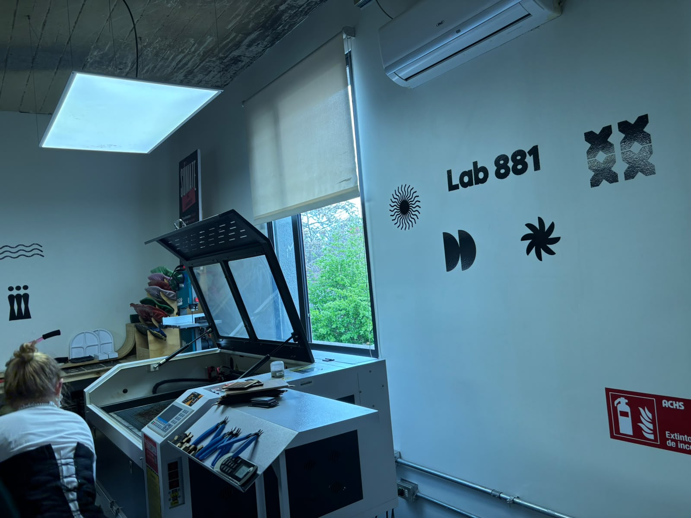
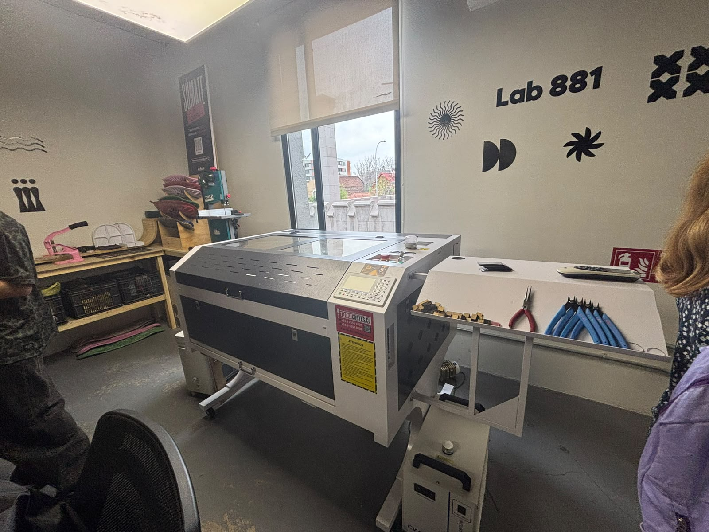
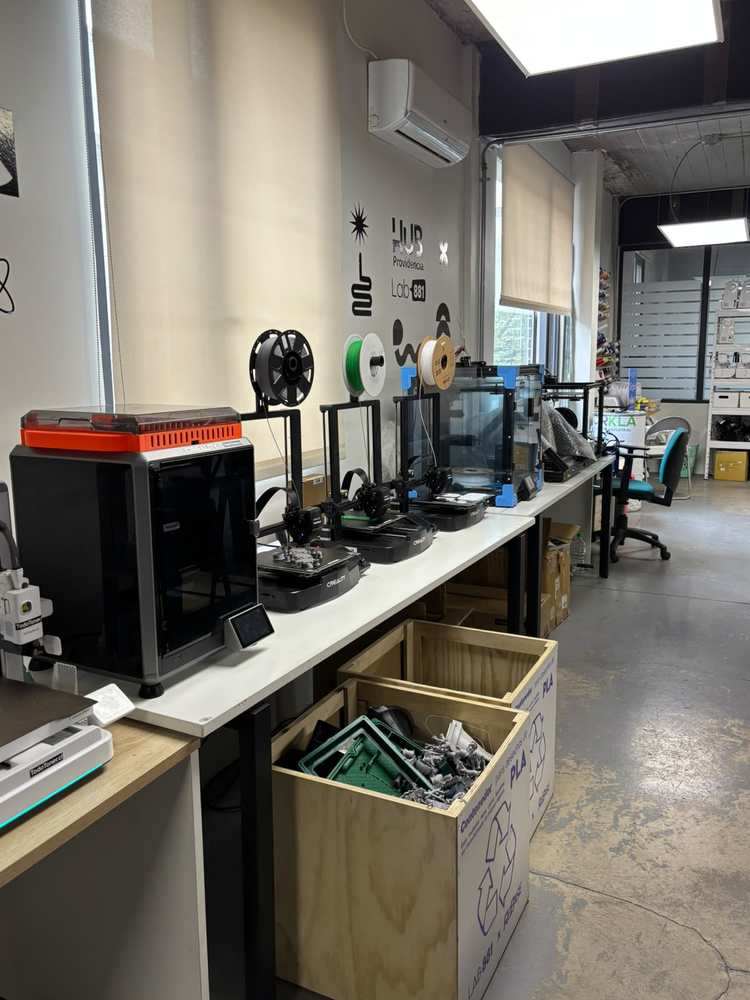
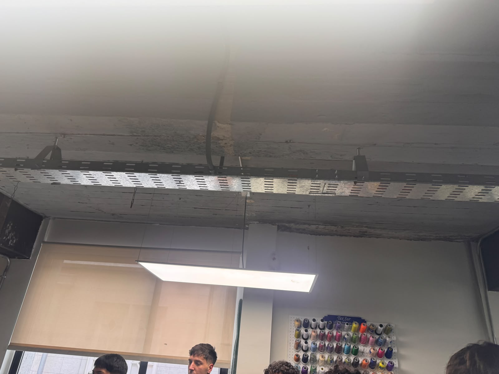
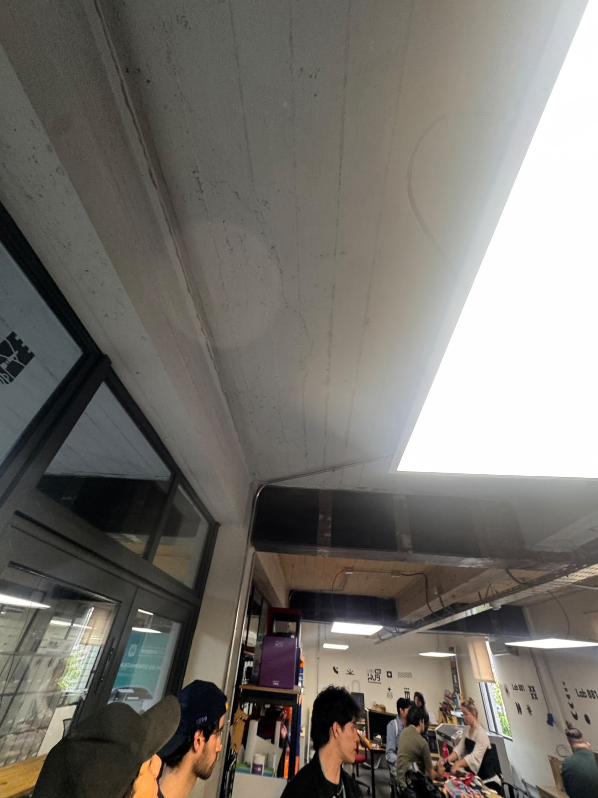

# Bitácora Semana 5 - Equipo SMAIRT

Desafío 06 – Sostenibilidad | Monitoreo y gestión de calidad del aire en Lab881

## MINUTA DE LA 5.ª REUNIÓN

| Fecha | 24 / 09 / 2026 |
| --- | --- |
| Hora | 14:00 |
| Lugar / modalidad | Presencial |
| Integrantes presentes | Matias Campos, Vanessa Contreras, Maximiliano Castro, Renato Bastías |
| Integrantes ausentes | Ninguno |

## 1. Objetivo de la semana
Visita al HUB de Providencia para solventar consultas o dudas respecto a la problemática y así trabajar en la solución.

## 2. Desarrollo del trabajo
### 3.1 Visita y reconocimiento en Lab881
Realizamos una visita presencial al espacio de fabricación Lab881 en Hub Providencia para observar directamente el entorno de trabajo y la operación de la maquinaria. Inspeccionamos la máquina de corte y grabado láser junto con el sistema de filtrado que se utiliza actualmente.

- **Hallazgos:** Confirmamos in situ que la máquina láser emite gases contaminantes y material particulado de manera constante durante su funcionamiento. El sistema de filtrado instalado es ineficiente y no da abasto para retener las emisiones en el recinto.
- **Dificultades:** Identificar la ubicación física óptima dentro del espacio para instalar el futuro prototipo sin entorpecer el flujo de trabajo de los operadores. 
- **Decisiones tomadas:** Se ratificó que la mitigación basada en la intuición de los operadores no funciona, por lo que avanzaremos obligatoriamente con el diseño de un sistema de monitoreo continuo.

### 3.2 Levantamiento de requerimientos técnicos
Analizamos el área para determinar cómo se estructurará la comunicación entre los componentes del prototipo. 

- **Hallazgos:** Los operadores carecen de paneles indicadores y toman medidas de ventilación "a ciegas", exponiéndose sin saber cuándo el ambiente es crítico.
- **Dificultades:** Faltan definir los componentes técnicos exactos y accesibles en el mercado local para la medición precisa.
- **Decisiones tomadas:** El sistema integrará ineludiblemente sensores de medición en tiempo real, una pantalla de visualización de datos y un sistema de alertas para activar la ventilación.

## 4. Validación: Certezas e Incógnitas

**Lo que sabemos (Certezas):**
- El foco físico de la problemática se ubica en el Lab881 del Hub Providencia.
- La fuente principal de contaminación comprobada es la cortadora láser.
- El sistema de filtrado de la máquina láser es insuficiente para la carga de trabajo habitual.
- La mitigación requiere un sistema de monitoreo compuesto por sensores en tiempo real y alertas para gestionar la ventilación de manera oportuna.

**Lo que necesitamos saber (Preguntas clave):**
- ¿Cuáles son los límites permisibles exactos según la normativa chilena (ej. D.S. 594) para configurar los umbrales de alerta?
- ¿Qué modelos específicos de sensores comerciales son viables para cuantificar compuestos orgánicos volátiles (VOCs) y material particulado (PM2.5 / PM10)?
- ¿Cómo armamos la lógica y el diagrama de flujo para que las alarmas avisen justo en el momento oportuno?

## 5. Avance del prototipo
| Componente | Estado | Detalle |
| --- | --- | --- |
| Sensores (MP, COV) | En curso | Selección comparativa de módulos para medición de material particulado y sensores de VOCs. |
| Pantalla de visualización | No iniciado | Definición pendiente del microcontrolador y el módulo de display. |
| Sistema de alertas | No iniciado | Elaboración pendiente del diagrama de estados para determinar cuándo activar avisos visuales y sonoros. |
| Comunicación / arquitectura | En curso | Estructuración inicial de los protocolos de comunicación entre los sensores y el módulo de visualización. |

## 6. Acuerdos y tareas para la próxima semana

| Tarea | Responsable | Fecha límite |
| --- | --- | --- |
| Investigar y listar opciones viables de sensores de material particulado y VOCs. | Renato Bastías | 01 / 10 / 2026 |
| Diseñar diagrama de flujo inicial sobre emisión de alertas visuales y sonoras. | Vanessa Contreras | 01 / 10 / 2026 |
| Investigar los límites permisibles de calidad del aire según normativa chilena. | Matías Campos | 30 / 09 / 2026 |
| Redactar propuesta de arquitectura del sistema (esquema de conexión). | Maximiliano Castro | 01 / 10 / 2026 |

## 7. Riesgos y apoyo requerido
- **Riesgos:** Retrasos en la toma de decisiones sobre la compra de los sensores definitivos, lo que podría aplazar el inicio de la programación del microcontrolador.
- **Apoyo requerido:** Necesitamos validación docente sobre la viabilidad técnica de los sensores preseleccionados y orientación sobre la normativa chilena aplicable al espacio cerrado.

## 8. Evidencias y anexos
- 
- 
- 

## 9. Reflexión del equipo
La visita al Hub Providencia fue fundamental para dimensionar espacialmente el problema y confirmar empíricamente la ineficacia del sistema de filtrado. El equipo logró un buen nivel de asistencia y participación, cumpliendo con el compromiso SMART de comunicación y responsabilidad asumido al inicio del Capstone. Identificamos que debemos acelerar la fase de investigación técnica (normativa y hardware) para no retrasar el ensamblaje del prototipo en las próximas semanas.
